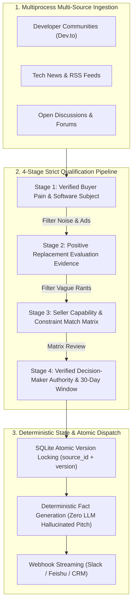

# 🎯 IntentRadar (商机雷达) — B2B Competitor Churn & High-Intent Interception Intelligence System

<p align="center">
  
  
  
  
</p>

> **Stop cold outreach.** Discover active competitor replacement demands across public engineering communities, verify buyer authority through a strict 4-stage deterministic qualification pipeline, and stream pre-vetted high-intent leads directly into your sales webhooks.

[Live Demo & Web Console](https://jakelihua.github.io/intent-radar-preview/) | [Architecture](#-system-architecture) | [Quickstart](#-quickstart) | [Commercial Inquiry](#-commercial-edition--consulting)

---

## ⚡ The Problem: The High Cost of Cold Leads

In B2B SaaS and Enterprise solutions, **95% of sales pipelines suffer from cold outreach burnout**:
- Finding prospects who *actually* want to replace an incumbent competitor (e.g. Jira, Salesforce, Datadog) requires hundreds of manual research hours.
- Raw community scrapers create **hallucination floods**: generic rants, supplier spam, and employees with zero purchasing power.
- Sales reps waste weeks chasing phantom deals.

**IntentRadar replaces probabilistic noise with deterministic buyer qualification.**

---

## 🏗️ System Architecture



---

## 🌟 Key Capabilities & Engineering Highlights

### 1. The 4-Stage Eligibility Verification Gate
* **Stage 1 (Pain Verification)**: Confirms genuine buyer struggle with a specific software tool; vendor marketing spam is strictly rejected.
* **Stage 2 (Replacement Intent)**: Demands concrete proof of an active migration/evaluation process (casual complaints stop here).
* **Stage 3 (Capability Matrix Matching)**: Verifies buyer must-have requirements against the seller’s real capability snapshot. Any mismatch halts qualification.
* **Stage 4 (Decision-Maker Authority)**: Manually and deterministically confirms the poster has evaluation authority, within a strict 30-day freshness window.

### 2. Deterministic AI over Hallucinated Autonomy
* **Conservative LLM Downgrading**: LLMs can safely downgrade qualifications upon detecting anomalies, but **are never allowed to upgrade an unqualified lead**.
* **Zero Creative Hallucination**: Outgoing push notifications are composed strictly from structured, verified facts — not unconstrained generative prompts.

### 3. Production-Grade Concurrency & Fault Tolerance
* **Isolated Subprocess Execution**: Individual sources run in dedicated processes with independent rate limiting, exponential backoff, and HTTP `Retry-After` adherence.
* **Atomic Claiming**: Prevents double-delivery in distributed webhooks via SQLite transactional version locks `(source, source_id, client_id, version)`.

---

## 🚀 Quickstart

### Prerequisites
- Python 3.9+
- Node 20+ (for end-to-end browser regression tests)

### 1. Installation
```bash
git clone https://github.com/jakelihua/intent-radar-preview.git
cd intent-radar-preview
python3 -m pip install -r requirements.txt
```

### 2. Run Local Verification Console (Demo Mode)
```bash
python3 main.py --demo
# Open report.html in your browser to inspect the interactive review workbench
open report.html
```

### 3. Run Production End-to-End Regression Suite
```bash
python3 -m pip install -r requirements-dev.txt
python3 -m unittest test_suite test_regressions -v
npm ci
npx playwright install chromium
npm run test:browser
```

---

## 💼 Commercial Edition & Advisory

IntentRadar is designed to be extensible for vertical B2B sales teams and cross-border SaaS operators:

- **Custom Source Ingestion**: Integrating private community webhooks, Reddit API, X/Twitter firehose, and CRM bi-directional sync.
- **Dedicated Enterprise Workbenches**: Custom multi-tenant deployment with Feishu/Slack automated alerting.
- **Architecture Advisory**: Tailoring deterministic agentic systems to your enterprise data pipelines.

📩 **Inquiries & Architecture Discussions**:
- **LinkedIn**: [Knight Wang](https://www.linkedin.com)
- **GitHub**: [@jakelihua](https://github.com/jakelihua)
- **WeChat / Business Inquiry**: `[Add your WeChat / Email here]`

---

## 📄 License

Distributed under the Apache 2.0 License. See `LICENSE` for more information.
